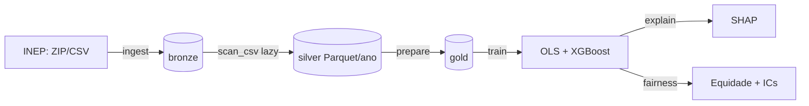

# 🎓 Desempenho no ENEM e Equidade

[](https://github.com/luanfreitas5/desempenho-enem-equidade/actions/workflows/ci.yml)
[](https://github.com/luanfreitas5/desempenho-enem-equidade/actions/workflows/tests.yml)
[](https://codecov.io/gh/luanfreitas5/desempenho-enem-equidade)
[](https://luanfreitas5.github.io/desempenho-enem-equidade/)

[](LICENSE)

Modelo **explicável** da nota do ENEM a partir do **perfil socioeconômico** e auditoria de
**equidade**: o quanto o desempenho — e o *erro do modelo* — difere por renda, raça/cor, tipo de
escola e região, sempre com intervalos de confiança.

## 🎯 Problema

O ENEM é a principal porta de entrada para o ensino superior no Brasil, e a nota está fortemente
associada às condições socioeconômicas dos candidatos. Quantificar essa associação de forma
transparente — e checar se um modelo preditivo erra mais para alguns grupos — é um passo básico
para qualquer uso responsável de dados educacionais.

## ❓ Pergunta

> Quanto do perfil socioeconômico declarado no questionário do ENEM é capaz de explicar a nota
> média do candidato, quais variáveis mais contribuem (global e por grupo) e o desempenho e o erro
> do modelo são equânimes entre grupos de renda, raça/cor, tipo de escola e região?

## 📦 Dados

- **Fonte:** [Microdados do ENEM](https://www.gov.br/inep/pt-br/acesso-a-informacao/dados-abertos/microdados/enem) (INEP), edições em `configs/config.yaml` (padrão: 2022 e 2023).
- **Formato:** CSV `;` em latin-1 (~1,5 GB por ano), lido com `pl.scan_csv` **lazy** e gravado em **Parquet particionado por ano**.
- **Alvo:** `mean_score`, média simples das 4 provas objetivas e da redação (0–1000).
- **Features:** somente o questionário socioeconômico (`Q001`–`Q025`). Raça/cor, tipo de escola e região **não** entram no modelo; servem para agrupar a análise de equidade.
- **Sem vazamento:** notas, gabaritos, presença e situação da redação são bloqueados como feature por código (`validate_no_leakage`) e por teste.
- Dicionário das variáveis usadas: [`docs/dicionario_dados.md`](docs/dicionario_dados.md). Datasheet: [`reports/datasheets/`](reports/datasheets/datasheet_enem.md).
- Os dados **não** estão no Git: baixe com `make ingest` (cache local + manifest com SHA-256).

> ⚠️ Nota técnica: o `scan_csv` lazy do Polars só lê UTF-8. Usamos `encoding="utf8-lossy"`, seguro aqui porque todas as colunas lidas são ASCII; apenas textos acentuados (não usados) são afetados.

## 🔁 Fluxo



| Etapa | Comando | Saída |
|---|---|---|
| 1. Ingestão | `make ingest` | `data/bronze/raw/<ano>/` e `data/silver/enem/ano=YYYY/` |
| 2. Preparação | `make prepare` | `data/gold/enem_gold.parquet`, funil de seleção |
| 3. Modelos | `make train` | `models/`, `reports/tables/{cv_*,test_metrics,linear_coefficients}.csv` |
| 4. Explicabilidade | `make explain` | `reports/tables/shap_*.csv`, `reports/figures/shap_*` |
| 5. Equidade | `make fairness` | `reports/tables/fairness_*.csv`, `reports/figures/fairness_*` |

## 🚀 Como reproduzir

Requisitos: Python 3.10+ e [uv](https://docs.astral.sh/uv/). ~6 GB livres em disco para 2 anos.

```bash
git clone https://github.com/luanfreitas5/desempenho-enem-equidade.git
cd desempenho-enem-equidade

uv sync --dev          # instala exatamente as versões do uv.lock
make hooks             # pre-commit + baseline do detect-secrets (opcional)

make pipeline          # ingestão -> preparação -> modelos -> SHAP -> equidade
# ou etapa a etapa: make ingest prepare train explain fairness
# um único ano:      uv run python src/main.py ingest --years 2023
```

- **Idempotente:** se a partição silver já existe, nada é baixado de novo (`--force` refaz).
- **Reprodutível:** semente única (`configs/config.yaml`), `PYTHONHASHSEED` exportado pelo Makefile, lock file commitado e SHA-256 dos dados/modelos em `manifest.json`/`model_comparison.json`.
- **Memória:** os modelos usam uma amostra (`modeling.sample_size`, padrão 500 mil linhas) — ajuste em `configs/model_params.yaml`.
- Testes e qualidade: `make test` · `make quality` · `make check` (o mesmo que o CI roda).

## 📊 Resultados

Execução de referência: edições **2022 e 2023**, **3.945.675** candidatos após o funil (53,25% dos 7,41 mi inscritos), amostra de 500 mil linhas (400 mil treino / 100 mil teste), semente 42, SHA-256 da gold `9dedd4ec…cf4d`. Todos os intervalos são IC 95%. Números completos em `reports/tables/`.

### Desempenho preditivo (teste, n = 100 mil)

| Modelo | RMSE | MAE | R² |
|---|---|---|---|
| Regressão linear (OLS) | 71,59 [71,24; 71,91] | 56,91 [56,60; 57,18] | 0,319 [0,314; 0,324] |
| Gradient boosting (XGBoost) | 70,98 [70,62; 71,31] | 56,41 [56,10; 56,67] | 0,330 [0,325; 0,335] |

- O perfil socioeconômico explica só **~33% da variância** da nota; o erro típico é de ~57 pontos (escala 0–1000).
- O boosting é melhor, mas **por pouco**: RMSE 0,61 ponto menor (IC bootstrap [0,55; 0,66]); teste t corrigido na CV, *p* = 6,6·10⁻⁶ (5 folds). Estatisticamente distinguível, praticamente pequeno: a relação é quase linear nas variáveis do questionário.
- A validação cruzada concorda com o teste (R² 0,327 ± 0,003 para o boosting), sem sinal de sobreajuste.

### O que mais pesa na nota (SHAP, boosting)

| # | Variável | \|SHAP\| médio (pontos) |
|---|---|---|
| 1 | Renda familiar (`Q006`) | 20,7 |
| 2 | Computador (`Q024`) | 14,2 |
| 3 | Escolaridade da mãe (`Q002`) | 6,8 |
| 4 | Freezer (`Q013`) | 5,1 |
| 5 | Escolaridade do pai (`Q001`) | 4,8 |

Renda e acesso a computador dominam. Itens de posse (freezer, TV por assinatura) funcionam como *proxies* de renda, não como causa: SHAP descreve o modelo, não efeitos causais.

### Desigualdade na nota

Diferença de nota média vs. grupo de referência (todas significativas):

| Eixo | Grupo vs. referência | Diferença |
|---|---|---|
| Renda | Até 1 SM vs. mais de 6 SM | **−128,9** [−130,7; −127,2] |
| Renda | 1 a 3 SM vs. mais de 6 SM | −89,0 [−90,8; −87,2] |
| Escola | Pública vs. privada | −87,4 [−89,0; −85,7] |
| Raça/cor | Indígena vs. branca | −82,1 [−88,7; −75,5] |
| Raça/cor | Preta vs. branca | −53,4 [−55,0; −51,8] |
| Região | Norte vs. Sudeste | −48,8 [−50,6; −47,2] |

### Equidade do erro do modelo (viés = previsto − observado, boosting)

- **Renda:** viés próximo de zero em todas as faixas (IC inclui 0): dado o perfil de renda, o modelo não erra sistematicamente por faixa.
- **Raça/cor, escola e região:** o modelo **superestima** quem tem desvantagem não captada pelas features. Viés vs. referência: indígenas **+32,5** [26,6; 38,1], pretos **+15,7** [14,4; 17,1], pardos +11,3, escola pública **+15,0** [13,4; 16,6], Centro-Oeste +13,0, Norte +11,7. Nordeste é a exceção (−1,2).
- Interpretação: pelo questionário, esses grupos parecem ter perfil que "deveria" render mais do que rendem; a diferença residual reflete fatores não observados (qualidade da escola, território). **Não** é evidência causal nem justifica a desigualdade.
- O erro absoluto (MAE) varia pouco entre grupos (53–60 pontos); grupos como indígenas (n = 517) têm IC largo, leia com cautela.

### Quem ficou de fora

| Etapa | Linhas | Retido |
|---|---|---|
| Inscritos | 7.410.060 | 100% |
| Não treineiro | 6.277.261 | 84,7% |
| Presente nas 4 provas | 4.094.596 | 55,3% |
| Redação válida | 3.945.675 | 53,3% |

A maior perda é a ausência nas provas (-2,18 mi), concentrada nos mais pobres: conclusões valem para **quem compareceu**.

Para reproduzir/ver detalhes: `test_metrics.csv`, `cv_summary.csv`, `model_comparison.json`, `fairness_gaps.csv`, `fairness_metrics.csv`, `shap_global.csv` e as figuras em `reports/figures/` (`shap_*`, `fairness_*`, `model_comparison`). O detalhamento por fatia está no [Model Card](reports/model_cards/model_card.md).

## ⚠️ Limitações e uso responsável

- **Viés de seleção:** só entram candidatos presentes nas 4 provas com redação válida. Quem falta (mais comum entre os mais pobres) fica fora; as conclusões valem para *quem compareceu*.
- **Associação, não causalidade:** renda e escolaridade dos pais se correlacionam com muitos fatores não observados (qualidade da escola, território, capital cultural). SHAP descreve o **modelo**, não o efeito causal de uma variável.
- **Dados autodeclarados:** questionário e raça/cor não são verificados; `Q001`/`Q002` têm categoria "não sei"; a renda é categórica e agrupada em faixas de salário mínimo.
- **Equidade ≠ ausência de atributos:** retirar raça/cor, escola e região das features **não** garante tratamento equânime (proxies). Por isso o erro é medido por grupo. Diferença de erro entre grupos não é causa nem justificativa da desigualdade.
- **`TP_ESCOLA` incompleto:** grande parte dos candidatos tem "Não respondeu" (a informação vem sobretudo de concluintes), o que limita a leitura por tipo de escola.
- **Grupos pequenos:** grupos com menos de `fairness.min_group_size` linhas são omitidos; para os demais, intervalos largos indicam incerteza real — leia-os.
- **Escopo temporal:** modelo treinado em edições específicas; mudanças de prova, calibração (TRI) ou perfil dos candidatos exigem revalidação (não há avaliação *out-of-time* ainda).
- **Amostragem:** métricas usam amostra reprodutível das linhas (configurável) e hiperparâmetros fixos, sem busca/tuning.
- **Uso:** apenas análise agregada e educacional. **Não** use para decisões sobre pessoas (seleção, bolsas, triagem) nem para prever o desempenho individual.
- **LGPD:** dados públicos já anonimizados pelo INEP; o projeto descarta o identificador de inscrição, não publica linhas individuais e suprime grupos pequenos. Raça/cor é dado sensível: use somente de forma agregada.

## 🗂️ Estrutura

```
configs/        YAML validados com Pydantic (config, paths, model_params, logging)
data/           bronze/ silver/ gold/  (fora do Git)
notebooks/      01_eda.ipynb (exploração; lógica fica em src/)
src/
  config/       settings, paths, logging (rich), seeds
  constants/    colunas, rótulos, nomes de artefatos
  data/         downloader (cache + manifest), reader (scan_csv), writer, loader, sampler, splitter
  preprocessing/ cleaning (raw->silver), filtering (funil), encoding
  features/     engineering (alvo, grupos), selection (anti-vazamento)
  schemas/      contratos Pandera (silver, gold)
  models/       OLS (statsmodels), XGBoost, persistência
  training/     validação cruzada
  evaluation/   métricas, ICs (t, bootstrap), teste t corrigido
  explainability/ SHAP global e por grupo
  fairness/     métricas por grupo e diferenças vs. referência
  visualization/ tema e gráficos (PNG 300 dpi + SVG)
  pipelines/    etapas ingest / prepare / train / explain / fairness
  main.py       CLI (argparse)
tests/          unitários, propriedades (hypothesis), comportamentais e ponta a ponta
reports/        figures/ tables/ model_cards/ datasheets/
docs/           MkDocs Material + mkdocstrings
```

## 🧠 Decisões técnicas

- **Polars lazy + Parquet** em vez de pandas: 1,5 GB/ano lidos sem estourar memória (`sink_parquet`).
- **Pandera** como contrato nas fronteiras silver/gold: falha cedo com `DataValidationError`.
- **Sem DVC/MLflow:** os dados são públicos e reprodutíveis por script com manifest SHA-256; adicionar essas ferramentas seria complexidade sem ganho aqui. Entram se houver múltiplos experimentos/colaboradores.
- **Sem `fairlearn`:** o IC bootstrap das diferenças por grupo é implementado diretamente (`fairness/group_metrics.py`), com menos dependências e controle sobre o intervalo.
- **OLS como referência:** coeficientes interpretáveis com erros robustos (HC1); o boosting precisa justificar o ganho com teste estatístico, não só com um número.

## 📚 Documentação

[luanfreitas5.github.io/desempenho-enem-equidade](https://luanfreitas5.github.io/desempenho-enem-equidade/) · [Metodologia](docs/metodologia.md) · [Dicionário de dados](docs/dicionario_dados.md) · [Changelog](CHANGELOG.md)

## 📄 Licença

[MIT](LICENSE). Os microdados pertencem ao INEP e seguem seus termos de uso.
