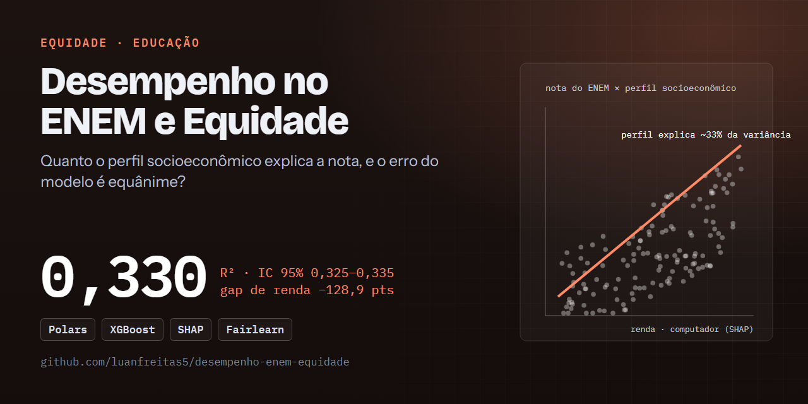
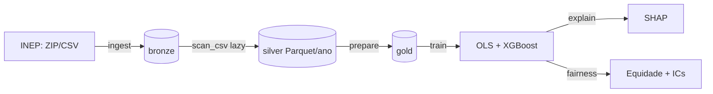
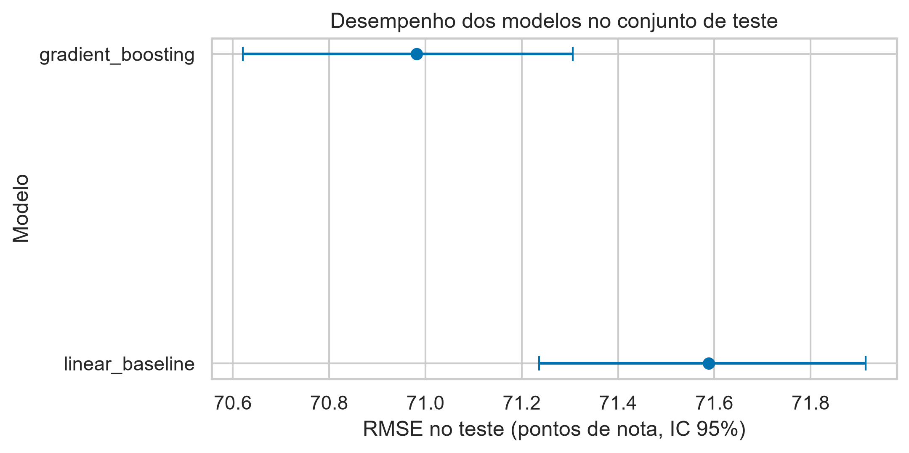
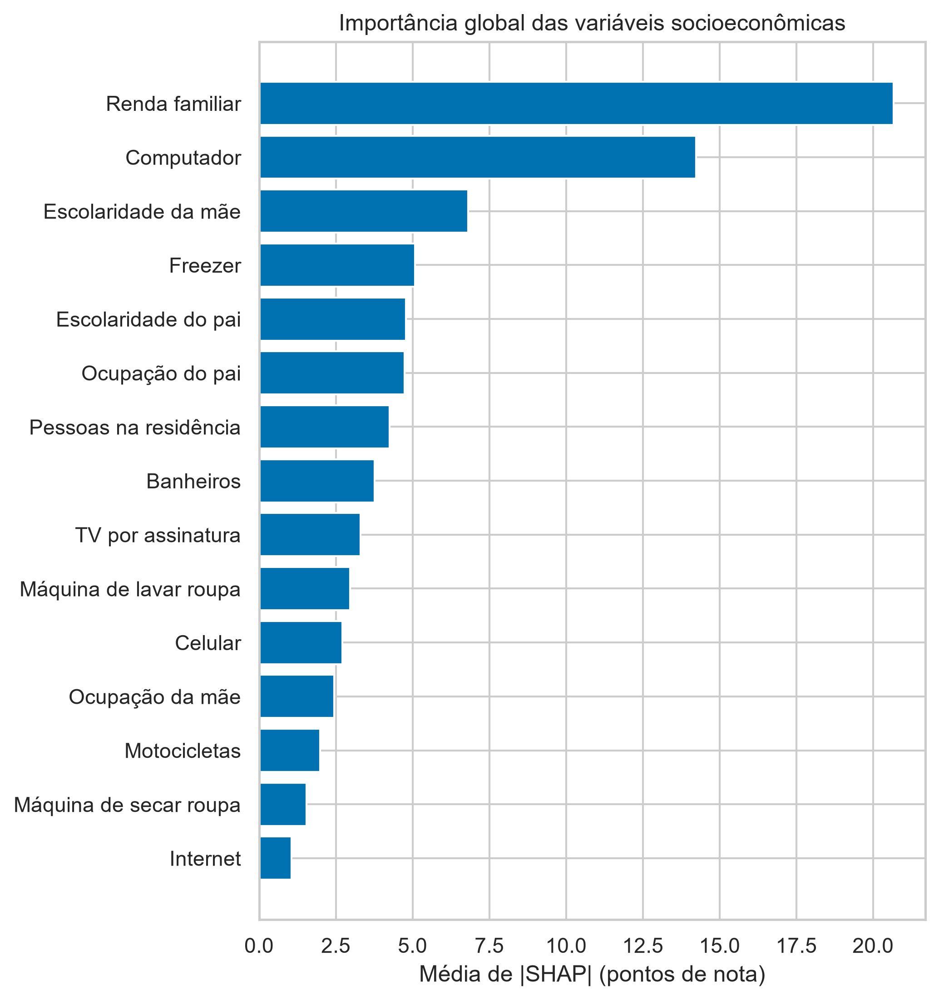
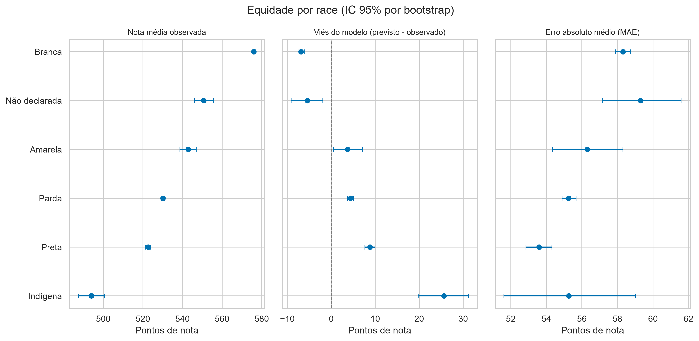

# 🎓 Desempenho no ENEM e Equidade: O perfil socioeconômico explica ~33% da nota do ENEM — e o modelo erra mais para quem tem desvantagem não observada

[](https://github.com/luanfreitas5/desempenho-enem-equidade/actions/workflows/ci.yml)
[](https://github.com/luanfreitas5/desempenho-enem-equidade/actions/workflows/tests.yml)
[](https://codecov.io/gh/luanfreitas5/desempenho-enem-equidade)
[](https://luanfreitas5.github.io/desempenho-enem-equidade/)
[](LICENSE)
 <!-- = matriz do CI (tests.yml) -->

> **Resultado:** o gradient boosting (XGBoost) atinge RMSE = **70,98 pontos (IC 95%: 70,62–71,31)** contra **71,59 (71,24–71,91)** da regressão linear (OLS), em 100 mil candidatos de teste do ENEM 2022–2023 (R² = 0,330). O ganho é real (*p* = 6,6·10⁻⁶) mas pequeno (0,61 ponto): o questionário socioeconômico sozinho não prevê a nota individual, mas permite **auditar** quem o modelo superestima — indígenas (+32,5 pontos de viés vs. brancos), pretos (+15,7) e alunos de escola pública (+15,0).



## 🎯 Problema

- **Quem decide o quê:** pesquisadores e gestores de política educacional avaliam o quanto o perfil socioeconômico declarado explica a nota e se um modelo preditivo erra de forma desigual entre grupos. O modelo **não** apoia decisões sobre pessoas.
- **Custo dos erros:** é regressão, sem custo assimétrico de FP/FN; o que importa é não subestimar a incerteza nem esconder grupos com erro sistematicamente enviesado → **métrica principal:** RMSE (penaliza erros grandes), com MAE e R² de apoio, sempre por grupo e com IC 95%.
- **Unidade de predição:** uma linha por candidato presente nas quatro provas; features = apenas o questionário `Q001`–`Q025`, respondido na inscrição (antes da prova, sem vazamento). Raça/cor, tipo de escola e região **não** entram no modelo: só agrupam a auditoria.

> **Pergunta:** quanto do perfil socioeconômico explica a nota média do candidato, quais variáveis mais contribuem (global e por grupo) e o desempenho e o erro do modelo são equânimes entre renda, raça/cor, tipo de escola e região?

## 🗂️ Dados

| Item | Valor |
|---|---|
| Fonte e licença | [Microdados do ENEM](https://www.gov.br/inep/pt-br/acesso-a-informacao/dados-abertos/microdados/enem) (INEP) — dados abertos, termos de uso do INEP; **não** redistribuídos aqui |
| Tamanho / período | 7.410.060 inscritos em 2022 e 2023; 3.945.675 após o funil (53,25%); modelos em amostra de 500 mil (400 mil treino / 100 mil teste) |
| Alvo e prevalência | `mean_score` (média das 4 provas e da redação, 0–1000); regressão, sem classe positiva |
| Formato | CSV `;` latin-1 (~1,5 GB/ano), lido com `pl.scan_csv` lazy e gravado em Parquet por ano |
| Sem vazamento | notas, gabaritos, presença e situação da redação são bloqueados como feature (`validate_no_leakage`) e por teste |
| Documentação | [Datasheet](reports/datasheets/datasheet_enem.md) · [Dicionário](docs/dicionario_dados.md) |

> ⚠️ Nota técnica: o `scan_csv` lazy do Polars só lê UTF-8. Usamos `encoding="utf8-lossy"`, seguro aqui porque todas as colunas lidas são ASCII; apenas textos acentuados (não usados) são afetados.

## 🔁 Fluxo



| Etapa | Comando | Saída |
|---|---|---|
| 1. Ingestão | `make ingest` | `data/bronze/raw/<ano>/` e `data/silver/enem/ano=YYYY/` |
| 2. Preparação | `make prepare` | `data/gold/enem_gold.parquet`, funil de seleção |
| 3. Modelos | `make train` | `models/`, `reports/tables/{cv_*,test_metrics,linear_coefficients}.csv` |
| 4. Explicabilidade | `make explain` | `reports/tables/shap_*.csv`, `reports/figures/shap_*` |
| 5. Equidade | `make fairness` | `reports/tables/fairness_*.csv`, `reports/figures/fairness_*` |

## 📊 Resultados

Protocolo: 400 mil linhas de treino / 100 mil de teste (amostra reprodutível), CV em 5 folds no treino, semente 42, hiperparâmetros fixos (sem tuning). IC 95% por **bootstrap no teste** (e t de Student sobre os folds na CV). Gold com SHA-256 `9dedd4ec…cf4d`.

| Modelo | RMSE (IC 95%) | MAE (IC 95%) | R² (IC 95%) |
|---|---|---|---|
| Baseline: regressão linear (OLS) | 71,59 (71,24–71,91) | 56,91 (56,60–57,18) | 0,319 (0,314–0,324) |
| Gradient boosting (XGBoost) | **70,98 (70,62–71,31)** | **56,41 (56,10–56,67)** | **0,330 (0,325–0,335)** |

- **Diferença vs. baseline:** RMSE 0,61 ponto menor (IC bootstrap pareado 0,55–0,66); teste t reamostrado corrigido na CV, *t* = 30,8, *p* = 6,6·10⁻⁶ (4 g.l.). Estatisticamente distinguível, praticamente pequeno: a relação é quase linear nas variáveis do questionário.
- **CV concorda com o teste:** R² 0,327 ± 0,003 (boosting) e 0,318 ± 0,003 (OLS), sem sinal de sobreajuste.
- **O perfil explica só ~33% da variância**; o erro típico é de ~57 pontos (escala 0–1000).
- **Pior segmento:** em erro absoluto, renda de 3 a 6 SM (MAE 60,4); em viés, indígenas (+25,6 [19,8; 31,2], n = 517) — ver [Model Card](reports/model_cards/model_card.md).



### O que mais pesa na nota (SHAP, boosting)

| # | Variável | \|SHAP\| médio (pontos) |
|---|---|---|
| 1 | Renda familiar (`Q006`) | 20,7 |
| 2 | Computador (`Q024`) | 14,2 |
| 3 | Escolaridade da mãe (`Q002`) | 6,8 |
| 4 | Freezer (`Q013`) | 5,1 |
| 5 | Escolaridade do pai (`Q001`) | 4,8 |

Renda e acesso a computador dominam. Itens de posse (freezer, TV por assinatura) funcionam como *proxies* de renda, não como causa: SHAP descreve o modelo, não efeitos causais.



### Desigualdade na nota

Diferença de nota média vs. grupo de referência (todas significativas):

| Eixo | Grupo vs. referência | Diferença |
|---|---|---|
| Renda | Até 1 SM vs. mais de 6 SM | **−128,9** [−130,7; −127,2] |
| Renda | 1 a 3 SM vs. mais de 6 SM | −89,0 [−90,8; −87,2] |
| Escola | Pública vs. privada | −87,4 [−89,0; −85,7] |
| Raça/cor | Indígena vs. branca | −82,1 [−88,7; −75,5] |
| Raça/cor | Preta vs. branca | −53,4 [−55,0; −51,8] |
| Região | Norte vs. Sudeste | −48,8 [−50,6; −47,2] |

### Equidade do erro do modelo (viés = previsto − observado, boosting)

- **Renda:** viés próximo de zero em todas as faixas (IC inclui 0): dado o perfil de renda, o modelo não erra sistematicamente por faixa.
- **Raça/cor, escola e região:** o modelo **superestima** quem tem desvantagem não captada pelas features. Viés vs. referência: indígenas **+32,5** [26,6; 38,1], pretos **+15,7** [14,4; 17,1], pardos +11,3, escola pública **+15,0** [13,4; 16,6], Centro-Oeste +13,0, Norte +11,7. Nordeste é a exceção (−1,2).
- Interpretação: pelo questionário, esses grupos parecem ter perfil que "deveria" render mais do que rendem; a diferença residual reflete fatores não observados (qualidade da escola, território). **Não** é evidência causal nem justifica a desigualdade.
- O erro absoluto (MAE) varia pouco entre grupos (53–60 pontos); grupos como indígenas (n = 517) têm IC largo, leia com cautela.



### Quem ficou de fora

| Etapa | Linhas | Retido |
|---|---|---|
| Inscritos | 7.410.060 | 100% |
| Não treineiro | 6.277.261 | 84,7% |
| Presente nas 4 provas | 4.094.596 | 55,3% |
| Redação válida | 3.945.675 | 53,3% |

A maior perda é a ausência nas provas (-2,18 mi), concentrada nos mais pobres: conclusões valem para **quem compareceu**.

Fontes dos números: [`model_comparison.json`](reports/tables/model_comparison.json), [`test_metrics.csv`](reports/tables/test_metrics.csv), [`cv_summary.csv`](reports/tables/cv_summary.csv), [`fairness_gaps.csv`](reports/tables/fairness_gaps.csv), [`fairness_metrics.csv`](reports/tables/fairness_metrics.csv), [`shap_global.csv`](reports/tables/shap_global.csv) e [`participation_funnel.csv`](reports/tables/participation_funnel.csv). Detalhamento por fatia no [Model Card](reports/model_cards/model_card.md).

## 🔁 Reproduzir

Requisitos: [uv](https://docs.astral.sh/uv/), `make` e ~6 GB livres em disco para 2 anos. Sem credenciais. Tempo: o da execução de referência não foi registrado; o download (~1,5 GB/ano) domina.

```bash
git clone https://github.com/luanfreitas5/desempenho-enem-equidade.git
cd desempenho-enem-equidade
```

<!-- verify:start -->
```bash
uv sync --locked
make pipeline   # ingest -> prepare -> train -> explain -> fairness
```
<!-- verify:end -->

Saída esperada: `reports/tables/test_metrics.csv` com `gradient_boosting` RMSE ≈ 70,98 e R² ≈ 0,330 (execução de referência: ENEM 2022–2023, semente 42; a versão de Python e o commit dessa execução não foram registrados, e wheels de outras versões podem deslocar a última casa decimal).

- Etapa a etapa: `make ingest prepare train explain fairness`; um único ano: `uv run python src/main.py ingest --years 2023`.
- **Idempotente:** se a partição silver já existe, nada é baixado de novo (`--force` refaz).
- **Reprodutível:** semente única (`configs/config.yaml`), `PYTHONHASHSEED` exportado pelo Makefile, `uv.lock` commitado e SHA-256 dos dados/modelos em `manifest.json`/`model_comparison.json`.
- **Memória:** ajuste `modeling.sample_size` (padrão 500 mil) em `configs/model_params.yaml`.
- **Desenvolvimento:** `make install` (dependências + hooks) · `make check` (lint, tipos, segurança, qualidade e testes — o que o CI roda) · `make smoke` (o que roda no pre-commit).

## 🗂️ Estrutura

```
configs/        YAML validados com Pydantic (config, paths, model_params) e logging.yaml (dictConfig)
data/           bronze/ silver/ gold/  (fora do Git)
notebooks/      01_eda.ipynb (exploração; lógica fica em src/)
src/
  config/       settings, paths, logging (dictConfig + rich), seeds
  constants/    colunas, rótulos, nomes de artefatos
  data/         downloader (cache + manifest), reader (scan_csv), writer, loader, sampler, splitter
  preprocessing/ cleaning (raw->silver), filtering (funil), encoding
  features/     engineering (alvo, grupos), selection (anti-vazamento)
  schemas/      contratos Pandera (silver, gold)
  models/       OLS (statsmodels), XGBoost, persistência
  training/     validação cruzada
  evaluation/   métricas, ICs (t, bootstrap), teste t corrigido
  explainability/ SHAP global e por grupo
  fairness/     métricas por grupo e diferenças vs. referência
  visualization/ tema e gráficos (PNG 300 dpi + SVG)
  pipelines/    etapas ingest / prepare / train / explain / fairness
  main.py       CLI (argparse)
tests/          unitários, propriedades (hypothesis), comportamentais e ponta a ponta
reports/        figures/ tables/ model_cards/ datasheets/
docs/           MkDocs Material + mkdocstrings
```

## 🧠 Decisões técnicas

- **Polars lazy + Parquet** em vez de pandas: 1,5 GB/ano lidos sem estourar memória (`sink_parquet`).
- **Pandera** como contrato nas fronteiras silver/gold: falha cedo com `DataValidationError`.
- **Sem DVC/MLflow:** os dados são públicos e reprodutíveis por script com manifest SHA-256; adicionar essas ferramentas seria complexidade sem ganho aqui. Entram se houver múltiplos experimentos/colaboradores.
- **Sem `fairlearn`:** o IC bootstrap das diferenças por grupo é implementado diretamente (`fairness/group_metrics.py`), com menos dependências e controle sobre o intervalo.
- **OLS como referência:** coeficientes interpretáveis com erros robustos (HC1); o boosting precisa justificar o ganho com teste estatístico, não só com um número.

## ⚠️ Limitações e uso responsável

- **Viés de seleção:** só entram candidatos presentes nas 4 provas com redação válida. Quem falta (mais comum entre os mais pobres) fica fora; as conclusões valem para *quem compareceu*.
- **Associação, não causalidade:** renda e escolaridade dos pais se correlacionam com muitos fatores não observados (qualidade da escola, território, capital cultural). SHAP descreve o **modelo**, não o efeito causal de uma variável.
- **Dados autodeclarados:** questionário e raça/cor não são verificados; `Q001`/`Q002` têm categoria "não sei"; a renda é categórica e agrupada em faixas de salário mínimo.
- **Equidade ≠ ausência de atributos:** retirar raça/cor, escola e região das features **não** garante tratamento equânime (proxies). Por isso o erro é medido por grupo. Diferença de erro entre grupos não é causa nem justificativa da desigualdade.
- **`TP_ESCOLA` incompleto:** grande parte dos candidatos tem "Não respondeu" (a informação vem sobretudo de concluintes), o que limita a leitura por tipo de escola.
- **Grupos pequenos:** grupos com menos de `fairness.min_group_size` linhas são omitidos; para os demais, intervalos largos indicam incerteza real — leia-os.
- **Escopo temporal:** modelo treinado em edições específicas; mudanças de prova, calibração (TRI) ou perfil dos candidatos exigem revalidação (não há avaliação *out-of-time* ainda).
- **Amostragem:** métricas usam amostra reprodutível das linhas (configurável) e hiperparâmetros fixos, sem busca/tuning.
- **Uso:** apenas análise agregada e educacional. **Não** use para decisões sobre pessoas (seleção, bolsas, triagem) nem para prever o desempenho individual.
- **LGPD:** dados públicos já anonimizados pelo INEP; o projeto descarta o identificador de inscrição, não publica linhas individuais e suprime grupos pequenos. Raça/cor é dado sensível: use somente de forma agregada.

## 📚 Documentação

[luanfreitas5.github.io/desempenho-enem-equidade](https://luanfreitas5.github.io/desempenho-enem-equidade/) · [Metodologia](docs/metodologia.md) · [Dicionário de dados](docs/dicionario_dados.md) · [Model Card](reports/model_cards/model_card.md) · [Datasheet](reports/datasheets/datasheet_enem.md) · [Changelog](CHANGELOG.md)

## 📄 Licença e citação

[MIT](LICENSE). Os microdados pertencem ao INEP e seguem seus termos de uso. Não há artigo associado, portanto não há `CITATION.cff`.
