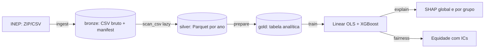

# Desempenho no ENEM e Equidade

Modelo explicável da nota do ENEM a partir do perfil socioeconômico e análise de
equidade do desempenho e do erro do modelo por renda, raça/cor, tipo de escola e região.

## Fluxo



## Como executar

```bash
uv sync --dev
make pipeline          # ou: make ingest prepare train explain fairness
```

Veja a [metodologia](metodologia.md), o [dicionário de dados](dicionario_dados.md) e a
[referência da API](api.md). O README do repositório traz as limitações e o uso responsável.
